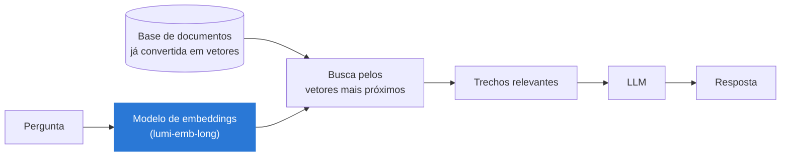
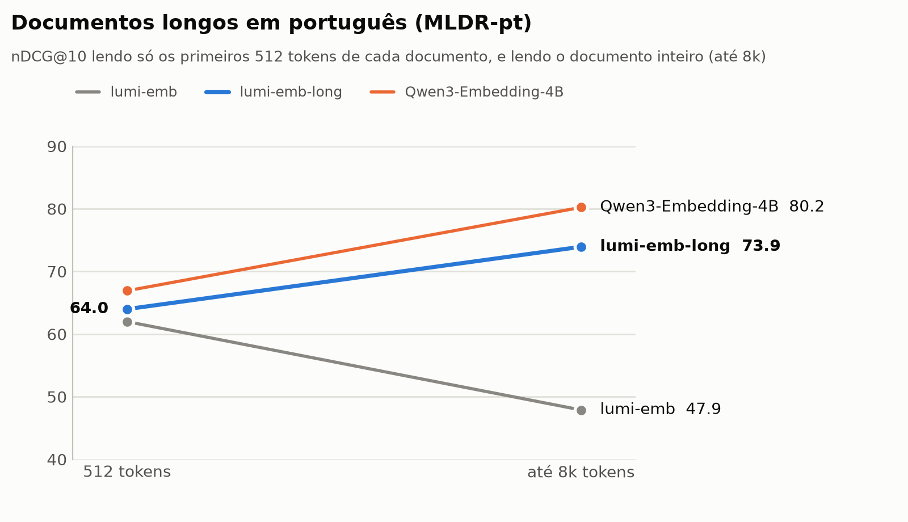
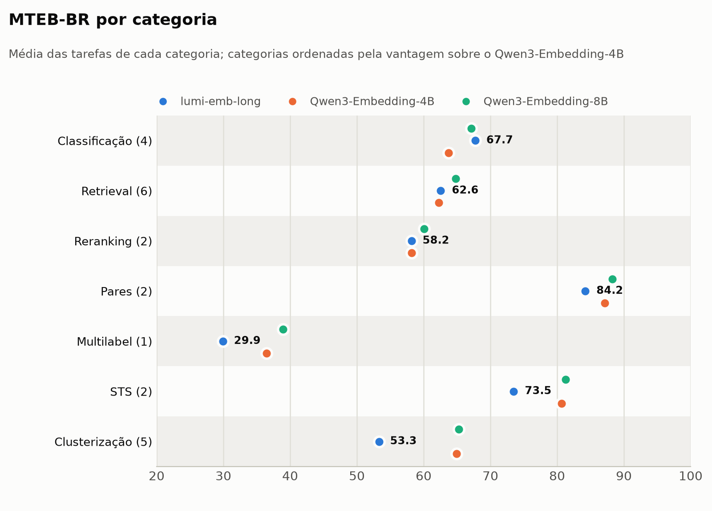
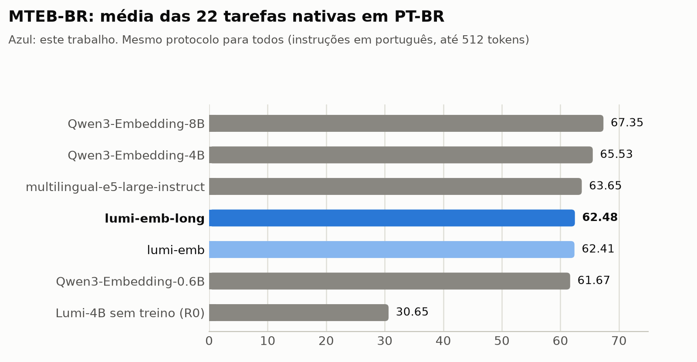
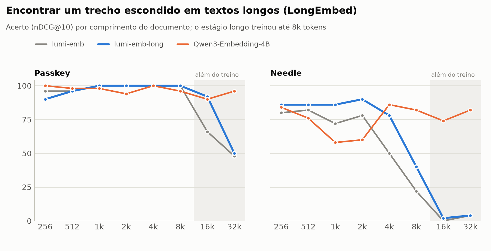
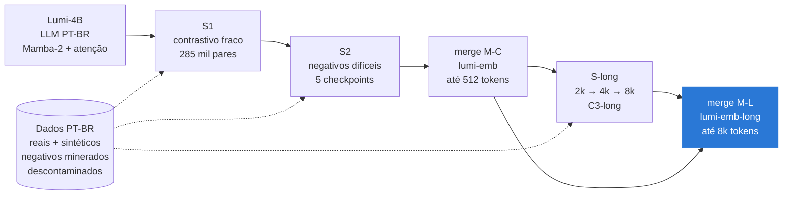
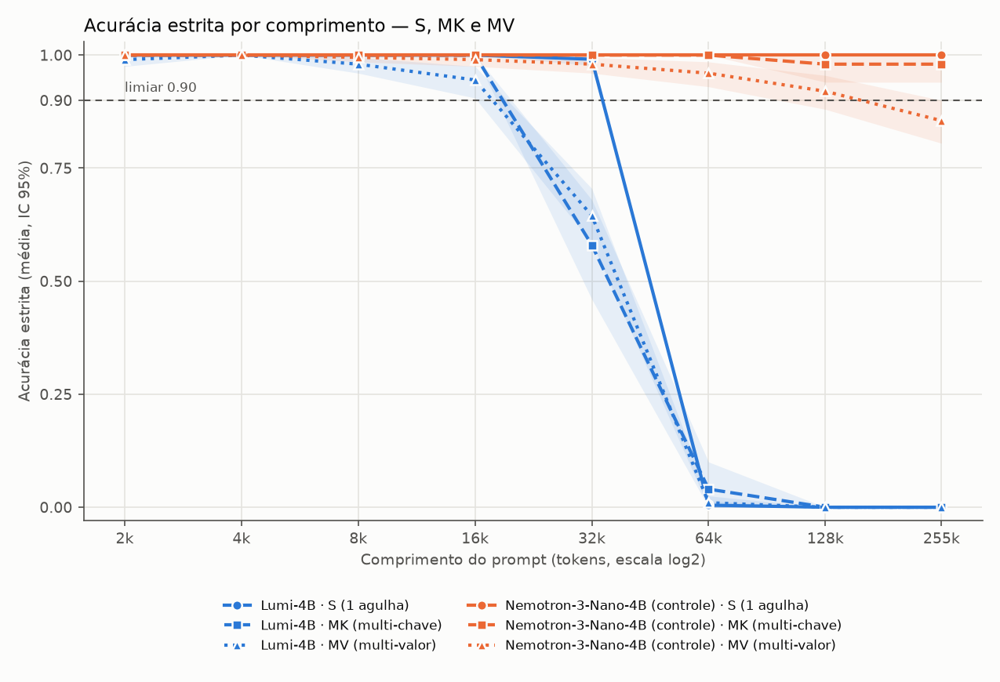

<div align="center">

# Lumi-Embed

**Um modelo de embeddings para português brasileiro, construído sobre um LLM híbrido Mamba-2 + atenção**

[](https://huggingface.co/henriquegalvao/lumi-4b-embedding)


[](#licenças)
[](LICENSE)

</div>

O **lumi-emb-long** transforma o [Lumi-4B](https://huggingface.co/ceia-research/lumi-4b), um LLM de 4B parâmetros focado em português brasileiro, num modelo de *embeddings* para busca semântica e RAG. Ele lê **documentos inteiros de até 8 mil tokens**, foi treinado com dados em PT-BR nativo e foi avaliado em mais de 40 tarefas, com o mesmo protocolo para todos os modelos comparados.

Até onde sabemos, é um dos primeiros embedders construídos sobre um híbrido Mamba-Transformer e avaliados a fundo em português. Este repositório traz o caminho inteiro, do LLM ao modelo publicado: a medição da janela de contexto, os dados, o treino, os merges, a avaliação e os testes.

*English readers: see the [English summary](#english-summary).*

## O que é um modelo de embeddings, em poucas palavras

Um modelo de *embeddings* transforma um texto numa lista de números, um vetor, que representa o seu significado. Textos com sentidos parecidos viram vetores próximos, mesmo quando usam palavras diferentes. Por exemplo, "como declarar gastos com médico?" fica perto de "despesas médicas podem ser deduzidas do imposto de renda". Com isso, dá para buscar por significado, e não só por palavras iguais.

No **RAG** (geração aumentada por recuperação), esse é o primeiro passo:
1. Os documentos de uma base (manuais, leis, contratos, perguntas frequentes) são convertidos em vetores uma única vez.
2. A cada pergunta, o modelo de embeddings encontra os trechos mais próximos dela.
3. Só esses trechos vão para o LLM que escreve a resposta.

Se a busca erra, o LLM responde com base no texto errado, e por isso a qualidade do modelo de embeddings pesa tanto. Além disso, quanto mais texto ele lê de uma vez, menos é preciso picotar os documentos. O lumi-emb-long lê até 8k tokens de uma vez, cerca de uma dezena de páginas.



## Destaques

Os termos técnicos estão explicados no [glossário](#glossário).

<!-- HIGHLIGHTS:START -->
|  | lumi-emb-long | Comparação |
|---|---|---|
| Documentos longos em PT (MLDR-pt, até 8k tokens) | **73.94** | 47.88 sem o estágio longo (+26.06); 63.99 lendo só os primeiros 512 tokens |
| MTEB-BR (22 tarefas nativas em PT-BR) | **62.48** | 30.65 do Lumi-4B sem treino |
| Classificação no MTEB-BR (4 tarefas) | **67.73** | maior média entre os 5 modelos comparados (depois: Qwen3-Embedding-8B, 67.13) |
| Retrieval no MTEB-BR (6 tarefas) | **62.56** | acima do Qwen3-Embedding-4B, de mesmo porte (62.29) |
| Retrieval no MTEB-PT | **77.87** | acima do Qwen3-Embedding-4B, de mesmo porte (77.14) |
| Reranking no MTEB-PT | **84.91** | acima do Qwen3-Embedding-4B, de mesmo porte (84.56) |

<picture>
  <source media="(prefers-color-scheme: dark)" srcset="docs/embed/figures/mldr-pt-dark.png">
  
</picture>

- **Empate estatístico** na média do MTEB-BR com Qwen3-Embedding-0.6B (Δ +0.81, p = 0.518) e multilingual-e5-large-instruct (Δ -1.17, p = 0.350).
- **O contexto longo não custou nada nos textos curtos:** lumi-emb-long − lumi-emb = +0.07 no MTEB-BR (p = 0.671).

### Onde ele se destaca

<picture>
  <source media="(prefers-color-scheme: dark)" srcset="docs/embed/figures/mteb-br-categories-dark.png">
  
</picture>

Nas tarefas abaixo (10 das 22 do MTEB-BR), o lumi-emb-long supera o Qwen3-Embedding-4B, um Transformer de mesmo porte, e as marcadas com ✓ superam também o Qwen3-Embedding-8B, com o dobro de parâmetros.

| Tarefa | Categoria | lumi-emb-long | Qwen3-Embedding-4B | Δ | > 8B |
|---|---|---|---|---|---|
| PortuLexRRIP | Classificação | **40.27** | 33.09 | +7.18 | ✓ |
| ToxSynPT | Classificação | **90.36** | 85.18 | +5.18 | ✓ |
| FaqBacenRetrieval | Retrieval | **68.54** | 64.42 | +4.12 | ✓ |
| JurisTCUClusteringP2P | Clusterização | **31.48** | 28.27 | +3.21 |  |
| HateBR | Classificação | **85.62** | 82.81 | +2.81 |  |
| MedPTRetrieval | Retrieval | **80.06** | 77.62 | +2.44 |  |
| FaQuADIR | Retrieval | **82.42** | 80.70 | +1.72 |  |
| Quati | Retrieval | **61.81** | 60.76 | +1.05 |  |
| FactckBrClassification | Classificação | **54.67** | 53.75 | +0.92 |  |
| QuatiReranking | Reranking | **60.65** | 60.57 | +0.08 |  |

<picture>
  <source media="(prefers-color-scheme: dark)" srcset="docs/embed/figures/mteb-br-ranking-dark.png">
  
</picture>

### Contexto longo

O estágio longo treinou com documentos de até 8k tokens. Nessa faixa, o modelo encontra a informação escondida bem melhor do que antes dele.

<picture>
  <source media="(prefers-color-scheme: dark)" srcset="docs/embed/figures/longembed-length-dark.png">
  
</picture>

<!-- HIGHLIGHTS:END -->

Todos os números acima saem do comando `report`, direto dos arquivos de resultado da avaliação. Nenhuma célula é digitada à mão. As tabelas completas, com ICs de 95 % e todos os checkpoints, estão em [docs/embed/RESULTS.md](docs/embed/RESULTS.md).

## O que este trabalho entrega

- **Um embedder de verdade a partir de um LLM generativo.** Sem treino, o Lumi-4B fica em 30,65 no MTEB-BR e praticamente zero em retrieval. O lumi-emb-long chega a 62,48, no mesmo patamar de embedders já estabelecidos: na média, empata estatisticamente com o multilingual-e5-large-instruct e o Qwen3-Embedding-0.6B.
- **Documentos inteiros, não só trechos.** Um estágio curto de contexto longo (LoRA, 755 passos, currículo de 2k → 4k → 8k tokens) fez o modelo aproveitar o documento inteiro. No MLDR-pt, ler até 8k tokens passou de 47,88 para 73,94. Nos textos curtos, o desempenho ficou igual.
- **Forte onde o português brasileiro é mais específico.** O modelo supera o Qwen3-Embedding-4B, um Transformer de mesmo porte, em 10 das 22 tarefas do MTEB-BR. Entre elas estão busca em perguntas frequentes do Banco Central, textos médicos, detecção de discurso de ódio e de toxicidade e textos jurídicos. Em classificação, tem a maior média entre todos os modelos comparados, incluindo o Qwen3-Embedding-8B.
- **Um retrato do backbone.** A [Etapa 1](docs/stage1/README.md) mediu até onde o Lumi-4B recupera informação (L\* de 16k a 32k). Essa medição definiu o comprimento do treino.
- **Uma receita aberta e verificável:**
  - dados em PT-BR nativo, gerados por três modelos abertos;
  - negativos difíceis minerados;
  - filtro de contaminação, com auditoria;
  - merges escolhidos no dev, nunca nos testes;
  - tabelas geradas só a partir dos resultados;
  - mais de 100 testes que rodam sem GPU.

## Uso rápido

```python
from sentence_transformers import SentenceTransformer

model = SentenceTransformer("henriquegalvao/lumi-4b-embedding", model_kwargs={"dtype": "bfloat16"})
queries = ["quais as regras para dedução de despesas médicas no imposto de renda?"]
docs = ["As despesas médicas podem ser deduzidas da base de cálculo do imposto de renda."]
q = model.encode(queries, prompt_name="query")   # a instrução de busca vai só na query
d = model.encode(docs)                            # documentos de até 8k tokens, sem instrução
print(model.similarity(q, d))
```

O [model card](docs/huggingface/README.md#uso) traz o uso com Transformers, os kernels Mamba-2 otimizados e o formato das instruções. A versão anterior, treinada só com textos curtos, continua disponível em `revision="lumi-emb"`.

## Como foi feito



1. **Janela de contexto (Etapa 1).** Teste *needle-in-a-haystack* em português, de 2k a 261k tokens, contra o modelo-base. O Lumi recupera bem até 16k–32k tokens, e isso definiu o teto de 8k para o treino.
2. **Dados.** Pares naturais (Wikipédia PT, mMARCO-PT, bitexto, uma fração em inglês) e sintéticos em PT-BR nativo, de três geradores abertos, com personas, tipos de consulta e dificuldades sorteados. Os negativos difíceis foram minerados pelo critério TopK-PercPos, e tudo passou por um filtro de contaminação contra as tarefas de avaliação.
3. **Treino contrastivo em estágios (LoRA).** O S1 tem negativos do batch e batch efetivo de 2048. O S2 usa 4 negativos difíceis. O S-long segue um currículo de 2k a 8k tokens, com 30 % de exemplos curtos repetidos para o modelo não esquecer os textos curtos.
4. **Merges escolhidos no dev.** O M-C junta cinco checkpoints do S2 e dá o **lumi-emb**. O M-L faz um SLERP entre o modelo longo e o lumi-emb e dá o **lumi-emb-long**. A regra de escolha foi fixada antes e nunca olha os testes.
5. **Avaliação ampla.** São 22 tarefas nativas do MTEB-BR, além do MTEB-PT, do LongEmbed, do MTEB (eng, v2) e do MLDR-pt com documentos de até 8k tokens. Os ICs de 95 % e os testes pareados usam bootstrap sobre as tarefas.

## O que as ablações mostraram

Cada ablação treina o modelo de novo com uma única peça trocada e compara as notas no MTEB-BR. Três lições:

- **A receita em dois estágios se paga.** Sem o S1, ou com os negativos difíceis escolhidos pelo top-k ingênuo (que tende a trazer falsos negativos para o treino), a média cai mais de um ponto.
- **O Lumi causal já basta.** Tornar o modelo bidirecional, como no LLM2Vec, exige um estágio a mais (MNTP) e não melhorou a média. Com o BiMamba, que roda o Mamba nos dois sentidos, a média piorou. Para este híbrido, a receita causal, com pooling pelo último token, é suficiente.
- **Os negativos difíceis não mudaram a média.** O C2-nohn, treinado só com os negativos do próprio lote, empatou com o C2 e foi melhor em STS. Ele teve a maior média do MTEB-BR entre os checkpoints treinados até aqui, no nível do modelo publicado, e cada passo é mais barato (2 textos por exemplo em vez de 6). Por isso, é o candidato para o próximo merge.

<!-- ABLATIONS:START -->
| O que foi testado | Comparação | Δ MTEB-BR [IC 95%] | p | Efeito |
|---|---|---|---|---|
| Estágio S1 (pares fracos em grande escala) antes do S2 | C2 − C2-direct | +1.24 [+0.58, +1.98] | < 0.001 | **ajuda** |
| Negativos difíceis filtrados (PercPos) em vez do top-k ingênuo | C2 − C2-naivehn | +1.28 [+0.61, +1.97] | < 0.001 | **ajuda** |
| Dados reais e sintéticos juntos no S2, em vez de só sintéticos¹ | C2 − C2-syn | +0.83 [+0.38, +1.36] | < 0.001 | **ajuda** |
| Dados reais e sintéticos juntos no S2, em vez de só reais¹ | C2 − C2-real | +0.23 [-0.27, +0.68] | 0.349 | empate |
| Merge de checkpoints (M-C) em vez do C2 sozinho | M-C − C2 | +0.44 [-0.05, +0.90] | 0.074 | empate |
| 4 negativos difíceis por exemplo no S2, em vez de só os do lote | C2 − C2-nohn | -0.55 [-1.12, +0.02] | 0.058 | empate |
| Negativos do lote somados aos difíceis, com máscara de falso negativo | C2-ib − C2 | -0.09 [-0.35, +0.13] | 0.459 | empate |
| Atenção bidirecional (Ba, com MNTP antes) | B2a − C2 | -0.23 [-0.79, +0.28] | 0.392 | empate |
| Atenção bidirecional + BiMamba (Bf, com MNTP antes) | B2f − C2 | -1.08 [-1.82, -0.34] | 0.005 | **piora** |
| Echo embeddings (texto repetido), sem treino | R0e − R0 | -2.30 [-4.54, -0.32] | 0.021 | **piora** |

Δ = média das 22 tarefas do MTEB-BR com o que foi testado menos a média sem ele (× 100), com IC de 95 % e p por bootstrap pareado nas tarefas. "Ajuda" ou "piora" quando o IC não cruza o zero. Para comparar, o C2 treinado com 3 sementes varia 0.13 (desvio-padrão) na média.

¹ Conjuntos de tamanhos diferentes: o S2-real e o S2-syn são menores que o S2 completo.

<!-- ABLATIONS:END -->

## Limitações, em resumo

- **Acima de 8k tokens, o ganho do estágio longo desaparece.** Documentos maiores devem ser divididos em trechos de até 8k.
- **Na média do MTEB-BR, ele ainda fica abaixo do Qwen3-Embedding-4B,** por cerca de 3 pontos. A distância está em clusterização e STS, tipos de tarefa que a mistura de treino quase não cobre. No LongEmbed, em inglês e com documentos de até 32k, a distância é maior.
- **Uso não comercial,** por causa dos dados de treino (mMARCO).

A lista completa está no [model card](docs/huggingface/README.md#limitações).

## English summary

**Lumi-Embed** turns [Lumi-4B](https://huggingface.co/ceia-research/lumi-4b), a 4B-parameter hybrid Mamba-2 + attention LLM for Brazilian Portuguese, into a text-embedding model for semantic search and RAG. The released model, **lumi-emb-long**, reads whole documents of up to 8k tokens.

- **Long documents:** on MLDR-pt with documents of up to 8k tokens, nDCG@10 goes from 47.88 to 73.94 after a short long-context stage, with no loss on short texts.
- **MTEB-BR (22 native PT-BR tasks):** 62.48. That is twice the untrained backbone (30.65), and statistically tied with multilingual-e5-large-instruct and Qwen3-Embedding-0.6B.
- **Strengths:** the highest classification average among the compared models (above Qwen3-Embedding-8B). Retrieval is above Qwen3-Embedding-4B, a Transformer of the same size, and the model beats it on 10 of the 22 MTEB-BR tasks.
- **Ablations:** the two-stage recipe and positive-aware hard-negative filtering each add more than one point. Making the hybrid bidirectional (LLM2Vec-style MNTP, with or without a reverse Mamba scan) does not help, so the causal model is enough. Training with in-batch negatives only ties the hard-negative stage.
- **Limitations:** the gains stop beyond 8k tokens. It is still about 3 points below Qwen3-Embedding-4B on average, mostly in clustering and STS. Non-commercial use.

**Recipe:**
- last-token (EOS) pooling;
- staged contrastive LoRA training: weakly supervised, then supervised with positive-aware hard negatives, then a 2k → 4k → 8k long-context curriculum with short-text replay;
- native PT-BR synthetic data from three open generators, plus natural pairs;
- checkpoint merges selected on a held-out dev set, never on test data;
- a clean zero-shot contamination policy, with a post-hoc audit.

As far as we know, it is one of the first hybrid Mamba-Transformer text embedders evaluated in depth in Portuguese. Model card (in Portuguese, with an English summary): [henriquegalvao/lumi-4b-embedding](https://huggingface.co/henriquegalvao/lumi-4b-embedding).

## Andamento

| Etapa | O que é | Estado | Documentação |
|---|---|---|---|
| **1. Janela de contexto** | Até quantos tokens o Lumi recupera informação de forma confiável (L\*) | ✅ concluída | [docs/stage1/](docs/stage1/README.md) |
| 2. Decisão | Desenho do embedder a partir do L\* | ✅ (abaixo) | — |
| 3. Dados | Pares naturais, sintéticos de 3 geradores, negativos minerados, descontaminação | ✅ S1, S2 e S-long | [ficha dos dados](docs/embed/DATA_CARD.md) |
| 4. Treino | LoRA contrastivo em estágios (S1, S2, S-long), merges | ✅ trilho causal, merges M-C e M-L, trilho bidirecional (Ba e Bf) e ablações A1–A5; demais ablações a seguir | [roteiro](docs/embed/PIPELINE.md) · [decisões](docs/embed/DECISIONS.md) |
| 5. Avaliação | MTEB-BR, MTEB-PT, LongEmbed, MTEB eng v2, MLDR-pt em 8k | ✅ lumi-emb, lumi-emb-long e ablações A1–A5 ([lições](#o-que-as-ablações-mostraram)) | [resultados](docs/embed/RESULTS.md) |

O desenho experimental completo das Etapas 2–5 está no [plano do experimento](docs/embed/plano_experimento.pdf).

---

## Etapa 1: janela de contexto efetiva

O teste foi *needle-in-a-haystack* em português, com prompts de 2k a 261k tokens, em três variantes: uma agulha (S), várias chaves (MK) e vários valores (MV). Foram 2.610 prompts por modelo, idênticos token a token entre o Lumi e o seu modelo-base, usado como controle.

| Modelo | L\* (S) | L\* (MK) | L\* (MV) | C0 |
|---|---|---|---|---|
| **Lumi-4B** | **32k** | **16k** | **16k** | 1,00 |
| Nemotron-3-Nano-4B (controle) | 255k | 255k | 128k | 1,00 |



- **Colapso em 64k:** em S, a acurácia do Lumi passa de 0,99 em 32k para 0,00 em 64k. As respostas entram em laço ou saem sem número.
- **Falha antes com várias agulhas:** em 32k, o MK cai para 0,58, e todos os erros são o número de outra cidade. O MV cai para 0,65.
- **A perda vem do pré-treino contínuo em janelas de 8k:** a base mantém 255k com os mesmos prompts, e as diferenças pareadas são enormes (p ≈ 10⁻⁶ a 10⁻⁶⁶).

**Decisão da Etapa 2.** O L\* efetivo é 16k. Por isso, o embedder treina primeiro com 512 tokens (S1/S2), como no plano, e depois estende o contexto até 8k num estágio separado (C3-long), bem dentro da faixa em que o backbone funciona. Metodologia completa, tabelas e figuras: [docs/stage1/](docs/stage1/README.md).

---

## Etapas 2–5: Lumi-Embed

### Desenho

O embedding é o estado oculto do último token, um `</s>` anexado ao texto, depois da normalização final. Ele é normalizado em L2 e comparado por cosseno. A instrução vai só na query, no formato `Instruct: {instrução}\nQuery: {query}`. Documentos não levam instrução.

| Trilho | Direção | Pooling | Estágios |
|---|---|---|---|
| **C** (principal) | causal (como pré-treinado) | último token (EOS) | S1 → S2 → S-long |
| **B** (experimental) | Ba: atenção bidirecional · Bf: + BiMamba (varredura reversa nos mixers Mamba-2, mesmos pesos) | média | S0 (MNTP) → S1 → S2 |

Os estágios:

- **S1 (contrastivo fraco):** InfoNCE (τ = 0,02), 1 negativo difícil por exemplo, batch efetivo de 2048 via GradCache e negativos do batch com máscara de falso negativo.
- **S2 (supervisionado):** 4 negativos difíceis TopK-PercPos e batch 128.
- **S-long:** currículo de 2k → 4k → 8k tokens, a partir do lumi-emb, com 30 % de replay do S2 e um dev longo próprio.

Os checkpoints seguem a Tabela 5 do plano:
- as referências R0 (zero-shot), R0e (echo) e R1 (receita do Mamba Retriever);
- C1 e C2, mais as variantes de ablação A1–A13;
- o estágio longo C3-long;
- B0–B2, do trilho bidirecional;
- os merges M-C, M-L e M-B, escolhidos **no dev**.

O resumo está no [model card](docs/huggingface/README.md#arquitetura-e-checkpoints).

### Como executar

Tudo roda na imagem `vllm/vllm-openai:v0.29.0`. O [`run_embed.sh`](run_embed.sh) cria dois ambientes:

- o do vLLM, para gerar os dados sintéticos e minerar negativos;
- um venv isolado com torch 2.12.1+cu130, para usar os kernels Mamba-2 pré-compilados do Hub no treino e na avaliação.

```bash
./run_embed.sh setup                                  # ambientes + testes
./run_embed.sh check                                  # vazão com/sem kernels, R0 exportado, T1–T4
./run_embed.sh eval R0 smoke mteb_br mteb_pt          # referência zero-shot
./run_embed.sh sources                                # dados reais e sementes
./run_embed.sh synth --generator qwen3_30b            # (e mistral_24b, gpt_oss_20b)
./run_embed.sh decontam && ./run_embed.sh mine && ./run_embed.sh mix
./run_embed.sh train C1 && ./run_embed.sh train C2    # e variantes / trilho B
./run_embed.sh merge M-C                              # → lumi-emb (jobs/embed/choose_release.py)
./run_embed.sh mix --only long && ./run_embed.sh train C3-long
./run_embed.sh merge M-L                              # → lumi-emb-long
./run_embed.sh eval lumi-emb-long smoke mteb_br mteb_pt longembed mldr_pt_long
./run_embed.sh report && ./run_embed.sh publish lumi-emb-long --release
```

O roteiro completo, com a ordem das etapas, as saídas, a retomada e as conferências antes de treinar, está em [docs/embed/PIPELINE.md](docs/embed/PIPELINE.md). Num cluster com o gerenciador de filas usado nos experimentos, cada comando vira um job com `bash jobs/embed/submit.sh <comando> …` ([jobs/README.md](jobs/README.md)).

### Verificações

Antes de publicar, todo checkpoint passa pelas verificações da seção 3.6 do plano:

| Teste | Critério |
|---|---|
| T1 | Invariância a padding e à composição do lote (cosseno ≥ 0,9999) |
| T2 | Causalidade no trilho C (estados anteriores idênticos) e bidirecionalidade no B |
| T3 | Posição do pooling igual ao cálculo manual |
| T4 | Ida e volta pelo `lumi_embed` e pelo Sentence-Transformers |
| T5 | Relatório de contaminação |
| T6 | Suíte *smoke* acima do R0 |

Depois de publicado, o `hubcheck` carrega o modelo do Hub exatamente como o card ensina e compara os embeddings com os do checkpoint local.

---

## Estrutura do repositório

```
.
├── run_stage1.sh / run_embed.sh   # pontos de entrada da Etapa 1 e das Etapas 2–5
├── configs/
│   ├── stage1.yaml, smoke.yaml    # Etapa 1
│   └── embed/                     # base, data, eval; train/<ID>.yaml (um por checkpoint); merge/
├── src/
│   ├── lumi_ctx/                  # Etapa 1: palheiro, prompts, vLLM, análise
│   └── lumi_embed/
│       ├── modeling/              # embedder (EOS/média), trilhos Ba/Bf, exportação HF + ST
│       ├── data/                  # fontes, síntese (vLLM), mineração, descontaminação, composição
│       ├── train/                 # perdas, GradCache, treino contrastivo, MNTP
│       ├── merge/                 # média, SLERP, interpolação com a âncora; grade + escolha no dev
│       ├── eval/                  # adaptador do mteb, suítes, dev, estatística, relatório, figuras
│       ├── verify.py, publish.py  # T1–T4, bench, R0; envio ao Hub
├── tests/                         # testes sem GPU (NemotronH minúsculo em CPU)
├── jobs/                          # descritores de job do cluster (Etapa 1 e submit.sh do Lumi-Embed)
├── docs/
│   ├── stage1/                    # Etapa 1: metodologia, relatório, figuras, tabelas
│   ├── embed/                     # plano (PDF), roteiro, ficha dos dados, decisões, resultados, figuras
│   └── huggingface/README.md      # model card do repositório do modelo
├── requirements*.txt, requirements-embed.lock
└── LICENSE                        # MIT (código)
```

## Reprodutibilidade e testes

- **Revisões fixadas:** modelos, datasets, geradores, teacher, imagem Docker, `requirements-embed.lock` (304 pacotes, resolvido para Linux x86_64) e o MTEB-BR por commit.
- **Determinismo:** sementes em toda a cadeia (palheiro, sementes, sorteios da síntese, composição dos conjuntos, ordem do treino).
- **Rastreabilidade:** cada checkpoint salva em `meta.json` a semente, o commit do código e a configuração completa. Cada merge guarda as notas no dev de todas as versões da grade.
- **Testes:** `./run_stage1.sh selftest` e `./run_embed.sh selftest` rodam os testes sem GPU. Eles usam um NemotronH minúsculo em CPU e cobrem:
  - os testes T1–T4;
  - a equivalência exata do GradCache;
  - os laços de treino com LoRA e completo, a retomada, o currículo de comprimento, o MNTP e os merges;
  - o pipeline de dados e a descontaminação;
  - o relatório e as figuras, gerados só a partir de resultados.

## Glossário

| Termo | O que significa |
|---|---|
| **Embedding** | Vetor de números que representa o significado de um texto. Textos parecidos viram vetores próximos. |
| **RAG** | Geração aumentada por recuperação: busca trechos relevantes numa base de documentos e os entrega a um LLM junto com a pergunta. |
| **Query e documento** | A pergunta de busca e o texto que pode respondê-la. Aqui, a query leva uma instrução curta, e o documento não. |
| **Similaridade de cosseno** | Medida de proximidade entre dois embeddings: quanto maior, mais parecidos os significados. |
| **Token** | Pedaço de palavra, a unidade que o modelo lê. 8k tokens equivalem a cerca de uma dezena de páginas. |
| **Janela de contexto e L\*** | Quanto texto o modelo consegue ler de uma vez. O L\* é o maior comprimento em que o Lumi-4B ainda acha uma informação escondida com pelo menos 90 % de acerto (Etapa 1). |
| **Transformer** | A arquitetura da maioria dos LLMs e modelos de embeddings, como o Qwen3-Embedding, baseada em camadas de atenção. |
| **Mamba-2 e modelo híbrido** | O Mamba-2 é um tipo de camada que lê o texto em sequência, guardando uma memória de tamanho fixo. O Lumi-4B é híbrido: mistura camadas Mamba-2 com algumas camadas de atenção. |
| **Pooling pelo último token (EOS)** | O embedding é o estado interno do modelo no token final (`</s>`), que resume o texto lido até ali. |
| **Treino contrastivo (InfoNCE)** | Ensina o modelo a aproximar a query do documento certo e a afastá-la dos errados. |
| **Negativos difíceis (TopK-PercPos)** | Documentos parecidos com o certo, mas que não respondem à pergunta; tornam o treino mais exigente. O critério TopK-PercPos descarta os candidatos parecidos demais com o certo, que provavelmente também respondem. |
| **LoRA** | Forma econômica de ajustar um modelo grande: em vez de mudar todos os pesos, treina pequenas matrizes extras. |
| **Checkpoint** | Uma versão salva do modelo durante o projeto (ex.: C2, C3-long). |
| **Merge e SLERP** | Combinar os pesos de modelos já treinados num só. O SLERP é uma interpolação entre dois modelos que segue a curvatura dos vetores de pesos. |
| **Dev** | Conjunto de exemplos separado, usado só para escolher entre checkpoints. Os benchmarks nunca entram nessa escolha. |
| **MTEB-BR, MTEB-PT** | Conjuntos de avaliação em português: o MTEB-BR tem 22 tarefas nativas do Brasil (classificação, busca, agrupamento e outras); o MTEB-PT reúne tarefas em português por família. |
| **LongEmbed e MLDR-pt** | Avaliações com documentos longos: o LongEmbed é em inglês, com documentos de até 32k tokens; o MLDR-pt é busca em documentos longos em português. |
| **Passkey e Needle** | Testes do LongEmbed em que uma informação curta é escondida num texto longo, e o modelo precisa achar o documento que a contém. |
| **nDCG@10** | Nota de 0 a 100 que mede se os documentos certos aparecem entre os 10 primeiros resultados da busca, valendo mais quanto mais perto do topo. |
| **Classificação, clusterização, STS, reranking** | Tipos de tarefa: atribuir rótulos a textos; agrupar textos por tema; dar nota à semelhança entre duas frases; reordenar uma lista de candidatos. |
| **IC 95 %, p-valor e empate estatístico** | O IC é a margem de incerteza de uma média. O p-valor é a chance de uma diferença daquele tamanho aparecer só por acaso. Com p ≥ 0,05, nenhuma diferença é declarada: os modelos estão em empate estatístico. |
| **Contaminação** | Quando textos dos testes aparecem no treino e inflam as notas. Aqui, eles são filtrados antes do treino, e uma auditoria confere o resultado. |

## Licenças

- **Código:** [MIT](LICENSE).
- **Modelos derivados:** **uso não comercial**. Eles derivam do `lumi-4b` e do Nemotron 3 Nano 4B (NVIDIA Nemotron Open Model License).
- **Dados de treino:** incluem o mMARCO/MS MARCO, de **uso não comercial**. Os detalhes estão na [ficha dos dados](docs/embed/DATA_CARD.md#licenças-o-que-isto-implica-para-o-modelo-decisão-d2).

## Referências

- [Model card do Lumi-4B](https://huggingface.co/ceia-research/lumi-4b) (CEIA/UFG).
- [Model card do Nemotron-3-Nano-4B](https://huggingface.co/nvidia/NVIDIA-Nemotron-3-Nano-4B-BF16).
- Waleffe et al., *An Empirical Study of Mamba-based Language Models* ([arXiv:2406.07887](https://arxiv.org/abs/2406.07887)).
- Hsieh et al., *RULER* ([arXiv:2404.06654](https://arxiv.org/abs/2404.06654)).
- Zhang et al., *Mamba Retriever* ([arXiv:2408.08066](https://arxiv.org/abs/2408.08066)).
- *Qwen3 Embedding* ([arXiv:2506.05176](https://arxiv.org/abs/2506.05176)).
- *Llama-Embed-Nemotron-8B* ([arXiv:2511.07025](https://arxiv.org/abs/2511.07025)).
- *NV-Retriever* ([arXiv:2407.15831](https://arxiv.org/abs/2407.15831)).
- *LLM2Vec* ([arXiv:2404.05961](https://arxiv.org/abs/2404.05961)).
- *MTEB-BR* ([arXiv:2607.04581](https://arxiv.org/abs/2607.04581)).
- *MTEB-PT* ([arXiv:2607.04071](https://arxiv.org/abs/2607.04071)).
- A lista completa está no apêndice B do [plano](docs/embed/plano_experimento.pdf).
