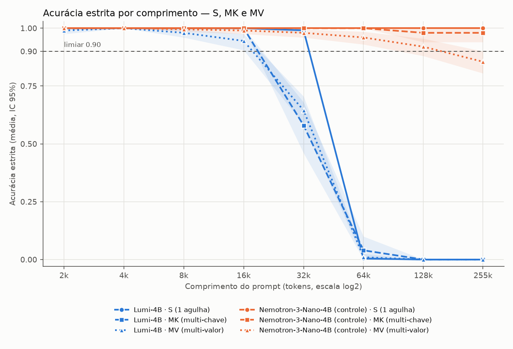

# Etapa 1 — janela de contexto efetiva do Lumi-4B

> Parte do projeto [Lumi-Embed](../../README.md). Este documento descreve em detalhe o experimento da Etapa 1; os artefatos da execução completa estão nesta mesma pasta ([`REPORT.md`](REPORT.md)).

A Etapa 1 mede **até quantos tokens o [Lumi-4B](https://huggingface.co/ceia-research/lumi-4b) recupera informação de forma confiável**. O resultado é o **L\***, o maior comprimento de entrada em que o modelo ainda encontra uma informação plantada num texto longo com acurácia ≥ 90 %. A medida usa testes do tipo *needle-in-a-haystack* (NIAH) em português, de 2 mil a 261 mil tokens. O modelo-base do Lumi, o [NVIDIA-Nemotron-3-Nano-4B](https://huggingface.co/nvidia/NVIDIA-Nemotron-3-Nano-4B-BF16), roda nas mesmas condições como controle.

O L\* define o desenho do embedder nas etapas seguintes: se ele codifica documentos inteiros ou trechos (*chunks*), e até que comprimento vai o currículo de treino.

**Sumário:**
[1. Contexto](#1-contexto) ·
[2. Modelos](#2-modelos-avaliados) ·
[3. Desenho experimental](#3-desenho-experimental) ·
[4. Métricas e estatística](#4-métricas-e-análise-estatística) ·
[5. Como executar](#5-como-executar) ·
[6. Saídas](#6-saídas) ·
[7. Reprodutibilidade](#7-reprodutibilidade) ·
[8. Testes](#8-testes-sem-gpu) ·
[9. Desvios](#9-desvios-em-relação-ao-plano-original) ·
[10. Limitações](#10-limitações) ·
[11. Estrutura](#11-estrutura-do-repositório) ·
[12. Resultados](#12-resultados) ·
[13. Licenças](#13-licenças)

---

## 1. Contexto

O objetivo do projeto é transformar o Lumi-4B, um modelo de linguagem de 4B parâmetros focado em português brasileiro, num modelo de *embeddings* para RAG. O trabalho tem algumas etapas, e este repositório cobre a primeira.

**Hipótese.** O Lumi é um modelo híbrido Mamba-2 + atenção, **sem codificação posicional explícita** (não há RoPE). Modelos assim tendem a generalizar além do comprimento visto no treino ([Waleffe et al., 2024](https://arxiv.org/abs/2406.07887)). A base anuncia contexto de até 262k tokens e 91,1 no RULER a 128k. O Lumi, porém, passou por pré-treino contínuo (50B tokens) em **janelas de 8.192 tokens**. Não se sabe se ele manteve o contexto longo da base.

**Por que um controle.** Comparar o Lumi com a própria base, nas mesmas condições, isola o efeito do pré-treino contínuo. Se a base vai bem até ~128k e o Lumi cai logo depois de 8k, a perda vem do pré-treino curto. Nesse caso, a Etapa 4 precisa de um *fine-tuning* de contexto longo antes do treino contrastivo.

## 2. Modelos avaliados

| | Lumi-4B (alvo) | Nemotron-3-Nano-4B (controle) |
|---|---|---|
| Repositório | [`ceia-research/lumi-4b`](https://huggingface.co/ceia-research/lumi-4b) | [`nvidia/NVIDIA-Nemotron-3-Nano-4B-BF16`](https://huggingface.co/nvidia/NVIDIA-Nemotron-3-Nano-4B-BF16) |
| Revisão fixada | `27b30f40b930fd05cee5e1c1f8790f70fa5b816d` | `dfaf35de3e30f1867dd8dbc38a7fc9fb52d3914f` |
| Arquitetura | `NemotronHForCausalLM`: 42 camadas (21 Mamba-2, 17 MLP, 4 de atenção) | idem (é a base do Lumi) |
| Posição | sem RoPE | sem RoPE |
| `max_position_embeddings` | 262144 (herdado; não validado no Lumi) | 262144 |
| Treino relevante | pré-treino contínuo PT-BR, 50B tokens, janela de 8.192, depois SFT | RULER 128k = 91,1 (modo sem raciocínio) |
| Modo de raciocínio | **desligado** (o model card exige) | desligado, para comparação justa |

Os dois modelos usam **o mesmo tokenizer** (vocabulário de 131.072) e **o mesmo chat template**. Isso foi verificado no código: a impressão digital do `tokenizer.json` e o hash do template coincidem. Por isso, cada prompt é idêntico token a token nos dois modelos, e a comparação é pareada.

**Memória teórica**, calculada a partir do `config.json` e registrada em cada relatório:

- KV cache, só nas 4 camadas de atenção: 4 × 2 (K e V) × 8 cabeças KV × 128 dimensões × 2 bytes = **16 KiB por token**, ou cerca de 4 GiB em 262k tokens.
- Estado Mamba em fp32: 21 camadas × 96 cabeças × 80 × 128 × 4 bytes ≈ **83 MB por sequência**, constante, qualquer que seja o comprimento.

O modelo não é alterado de forma alguma: nada de YaRN, `rope_scaling` ou edição do `config.json`.

## 3. Desenho experimental

### 3.1 Tarefas

Todas as agulhas seguem a mesma frase: **`O número mágico de {cidade} é {N}.`**

- `{cidade}` vem de uma lista fixa de 60 cidades brasileiras ([`needles.py`](../../src/lumi_ctx/needles.py)). Nenhum nome está contido em outro, para que a pergunta nunca seja ambígua (ex.: não há "Vitória" e "Vitória da Conquista").
- `{N}` é um inteiro de 7 dígitos (1.000.000 a 9.999.999), distinto dentro de cada prompt.

| ID | Tarefa | O que o prompt contém | Pontuação |
|---|---|---|---|
| **C0** | Controle sem palheiro | só a agulha e a pergunta (~95 tokens) | acerto exato. **Gate: ≥ 95 %** |
| **S** | *Single needle* | 1 agulha no palheiro | acerto exato |
| **MK** | *Multi-key* | agulha-alvo + 3 distratoras com **outras cidades**, em posições aleatórias | acerto exato do valor da cidade perguntada |
| **MV** | *Multi-value* | 4 agulhas da **mesma cidade** com valores diferentes; a pergunta pede todos | fração dos 4 valores recuperados |

O C0 separa "não segue a instrução" de "não lida com contexto longo". Um modelo que erra o C0 não tem L\* interpretável.

### 3.2 Comprimentos

`2048, 4096, 8192, 16384, 32768, 65536, 131072, 261120` tokens. O comprimento conta **o prompt completo**, já renderizado com o chat template.

O último valor é 262144 − 1024. A margem de 1.024 tokens garante que prompt + resposta caibam em `max_model_len = 262144` (a resposta usa no máximo 128 tokens). Nas figuras, os comprimentos aparecem em unidades binárias (1k = 1.024), então 261120 aparece como "255k".

### 3.3 Profundidade da agulha

- **S:** 11 profundidades (0 %, 10 %, …, 100 %) da extensão do palheiro, medidas em tokens. 0 % põe a agulha antes da primeira frase; 100 %, depois da última.
- **MK e MV:** a agulha-alvo fica em {0, 25, 50, 75, 100} %. No MV, o "alvo" é o primeiro dos quatro valores. As demais agulhas ficam em posições aleatórias, com **distância mínima de 2 %** da extensão do palheiro entre quaisquer duas.
- A inserção é **sempre em fronteira de frase**. A profundidade realizada (a fronteira mais próxima do alvo) fica registrada em cada prompt (`target_depth_actual`).

### 3.4 Repetições e volume (por modelo)

| Tarefa | comprimentos × posições × repetições | prompts |
|---|---|---|
| C0 | 1 × 1 × 50 | 50 |
| S | 8 × 11 × 20 | 1760 |
| MK | 8 × 5 × 10 | 400 |
| MV | 8 × 5 × 10 | 400 |
| **Total** | | **2610 por modelo, 5220 nos dois** |

Cada repetição usa um trecho diferente do palheiro (início sorteado) e agulhas novas. O volume é de **166,6 M tokens de prompt por modelo** (333 M nos dois), quase todo de *prefill*: as respostas têm poucos tokens.

O modo **smoke** usa as mesmas sementes com menos repetições (C0 × 5; S nas profundidades 0/50/100 %; MK e MV a 50 %; 1 repetição), num total de **45 prompts por modelo**. Ele passa por todos os comprimentos, inclusive 261k. Os prompts do smoke são um subconjunto exato dos da execução completa.

### 3.5 Palheiro (texto de fundo em PT-BR)

- **Fonte:** [`wikimedia/wikipedia`](https://huggingface.co/datasets/wikimedia/wikipedia), *config* `20231101.pt`, na revisão `b04c8d1ceb2f5cd4588862100d08de323dccfbaa`. A Wikipédia em português é um texto enciclopédico neutro, sem relação com números mágicos de cidades, e tem licença aberta.
- **Leitura em *streaming*:** os parquets são lidos sob demanda, *row group* por *row group*, via `HfFileSystem` + `pyarrow`. A ordem dos *row groups* e dos artigos dentro de cada um é uma permutação determinada pela semente. Só os trechos necessários são baixados (o pool usa ~9 dos 1.116 *row groups*).
- **Filtros e limpeza:**
  - artigos com ≥ 2.000 caracteres no texto bruto;
  - Unicode NFC e espaços normalizados;
  - remoção de linhas com menos de 80 caracteres (títulos de seção, itens de lista), linhas de tabela, linhas majoritariamente numéricas e linhas que não terminam como frase;
  - remoção de resíduos de predefinições, como `( )`;
  - exclusão de **artigos que mencionam "número(s) mágico(s)"** (física nuclear, por exemplo), que confundiriam a tarefa.
- **Segmentação em frases:** expressão regular com uma lista de abreviações do português (Sr., Dr., séc., a.C., iniciais como "J. R. R."). Na dúvida, ela prefere *não* cortar: uma frase longa demais só deixa a granularidade mais grossa.
- **Tamanho:** o pool tem **2.560 artigos, 4,20 M tokens e 110.045 frases** (≥ 3 M tokens, para haver inícios variados até 261k). As frases têm em média 38 tokens (mediana 34, p95 77, p99 113).
- O pool é gravado em `data/haystack_pt.parquet`, com texto e offsets de início de frase, e reaproveitado entre execuções. A construção é determinística: duas construções independentes produziram o mesmo texto (mesmo hash).

### 3.6 Prompt

Mensagem única de usuário, sem *system prompt*:

```
Abaixo há um texto longo. Em algum ponto dele há informações sobre números mágicos.
Leia o texto e responda à pergunta no final.

<texto>
{palheiro com agulha(s)}
</texto>

Pergunta: Qual é o número mágico de {cidade}? Responda apenas com o número.
```

No MV, a pergunta é: `Quais são todos os números mágicos de {cidade}? Responda apenas com os números, separados por vírgula.`

O prompt é renderizado com o chat template do próprio modelo:

```python
ids = tok.apply_chat_template(msgs, add_generation_prompt=True, enable_thinking=False, tokenize=True)
```

Com `enable_thinking=False`, o template termina o prompt em `<|im_start|>assistant\n<think></think>`: o bloco de raciocínio já vem fechado e vazio. Antes de qualquer geração, o pipeline confere isso (gate G1) e grava um exemplo completo renderizado em `template_<modelo>.txt`. O template sempre emite um turno `system` vazio, mesmo sem *system prompt*. Esse turno faz parte do formato do modelo e conta no comprimento.

O vLLM recebe **IDs de token** (`{"prompt_token_ids": ids}`), não texto. Assim o comprimento que o modelo vê é exatamente o medido.

### 3.7 Construção com comprimento controlado

Para cada (tarefa, L, profundidade, repetição), em [`prompts.py`](../../src/lumi_ctx/prompts.py):

1. Um gerador próprio do prompt (`numpy.random.default_rng([semente, tarefa, L, profundidade, repetição])`) sorteia cidade(s) e número(s). O gerador não depende do modelo nem da ordem de execução.
2. **O** = tokens do template com o palheiro contendo só as agulhas. O orçamento do palheiro é **B = L − O**.
3. Sorteia-se um início de frase no pool. Juntam-se frases inteiras até somar ~B tokens. A soma usa um índice de tokens por frase pré-calculado, que erra em média < 0,1 % contra a tokenização real.
4. As agulhas entram em fronteiras de frase, nas profundidades definidas.
5. O prompt é renderizado e **medido na tokenização real**. Se passa de L, saem frases do fim; se fica abaixo de L·(1 − 2 %), entram frases. As agulhas nunca são removidas. Se nenhum ajuste encaixa, sorteia-se outro início.
6. Confere-se que **nenhum número de agulha aparece por acaso no palheiro**, em forma pura ou com separadores ("1.234.567", "1 234 567"). Se aparecer, o número é re-sorteado.

Critério de aceitação: **L·(1 − 0,02) ≤ comprimento ≤ L**. O construtor nunca passa do alvo. No conjunto completo (2.610 prompts):

- desvio máximo de 1,98 % (nos prompts de 2k, em que uma frase pesa mais);
- desvio médio de −0,29 %;
- nenhum prompt acima do alvo;
- 77 prompts precisaram de outro início sorteado;
- nenhuma colisão de número.

A construção leva ~30 s em 10 processos de CPU. O comprimento real de cada prompt fica registrado.

### 3.8 Geração e pontuação

- Decodificação gulosa: `temperature=0`, `max_tokens=64` (128 no MV), semente fixa (1234).
- Parada em `<|im_end|>` (id 11) e `</s>` (id 2). O `eos_token_id` do `config.json` é 2, mas o turno de chat termina em `<|im_end|>`.
- A saída é decodificada com `skip_special_tokens=False`, para que nenhum `<think>` fique escondido.
- **Estrita (principal):** o **primeiro** número de 7 dígitos da saída é igual ao esperado. No MV, conta a fração dos 4 valores esperados entre os números de 7 dígitos da saída.
- **Leniente:** o número esperado aparece em qualquer ponto da saída, aceitando também separadores de milhar. No MV, conta a fração dos valores que aparecem.
- **`thinking_leak`:** a saída contém `<think>` ou `</think>`, em texto ou como token. No C0 e em contextos curtos, isso indicaria erro de configuração (gate G3). Em contextos longos, aparece como parte do colapso do modelo (laços como `<think></think><think>…` até `max_tokens`) e é contado como modo de falha.
- **Diagnósticos por prompt:**
  - se a saída tinha algum número;
  - no MK, se o modelo devolveu o número de uma cidade distratora;
  - no MV, se recuperou os 4 valores e quantos números estranhos citou;
  - o motivo de parada.

### 3.9 Desempenho (secundário)

Para cada comprimento, um prompt S isolado (lote de 1) é medido depois de um aquecimento:

- ***Prefill*:** tempo para gerar 1 token.
- ***Decode*:** tokens/s gerando 128 tokens com `ignore_eos`, descontado o *prefill*.

Esse benchmark mede latência, não vazão. A vazão em lote da execução principal fica registrada por lote (`raw/throughput.jsonl`). O smoke usa as duas medidas para estimar o tempo da execução completa com 1, 2, 4 ou 8 GPUs.

## 4. Métricas e análise estatística

Para cada modelo × tarefa × comprimento:

- **Acurácia média** (estrita e leniente) e **IC 95 % por *bootstrap*** percentil (2.000 reamostragens). A reamostragem é estratificada por profundidade, preservando o desenho balanceado.
- **Acurácia mínima entre profundidades** (S), que mostra o efeito *lost in the middle*.

| Métrica | Definição |
|---|---|
| **L\*** | maior L com acurácia estrita média de S ≥ 0,90 **nele e em todos os comprimentos menores** |
| **L\*<sub>estrito</sub>** | idem, exigindo ≥ 0,90 em **toda** profundidade |
| **L\* conservador** | idem, usando o limite inferior do IC 95 % no lugar da média |
| **L\* (MK), L\* (MV)** | o mesmo critério aplicado às tarefas MK e MV |

Exigir o limiar em todos os comprimentos menores evita que um ponto isolado acima de 0,90 (por variância) estenda o L\* depois de uma queda.

**Comparação Lumi × controle.** Os prompts são idênticos nos dois modelos, então a comparação é **pareada**. Usa-se o teste exato dos sinais sobre as diferenças por prompt; com notas 0/1, ele equivale ao **McNemar exato**. O relatório traz Δ e o valor-p por tarefa e comprimento.

**Gates** (por modelo):

| Gate | Critério |
|---|---|
| G1 | O template desliga o raciocínio: o prompt termina com `<think></think>` fechado e difere do modo com raciocínio |
| G2 | C0 ≥ 95 % (acurácia estrita) |
| G3 | Nenhum `<think>` nas saídas do C0 nem em L ≤ 8k (`think_gate_max_length`), onde ele só pode vir de configuração errada; acima disso, a taxa é reportada como modo de falha |
| G4 | Todos os prompts com \|desvio\| ≤ 2 % e nenhum acima de L |
| G5 | Nenhum número de agulha presente por acaso no palheiro (verificado na construção) |
| G6 | Todas as gerações concluídas |

Se G1, G2, G3 ou G6 falham, o L\* daquele modelo é marcado como não confiável. Se G1 falha, a execução é abortada antes de gerar.

**Recomendação automática.** O relatório aplica a regra de decisão da Etapa 2 (seção 1) ao L\* de S e acrescenta duas ressalvas quando os dados pedem:

- **L\* efetivo:** o menor L\* entre S, MK e MV. Um embedder precisa separar vários fatos parecidos no mesmo documento.
- **Falta de margem:** quando a acurácia de S cai abaixo de 0,10 no comprimento seguinte ao L\*.

Ele também compara o L\* do Lumi com o do controle, para atribuir a perda ao pré-treino contínuo.

## 5. Como executar

### Requisitos

- GPU NVIDIA suportada pelo vLLM. O modelo ocupa ~8 GB em bf16, mais ~4 GiB de KV cache por sequência de 261k. Recomenda-se ≥ 40 GB por GPU. O código usa todas as GPUs visíveis, com um processo vLLM independente por GPU (paralelismo de dados).
- A imagem Docker oficial **`vllm/vllm-openai:v0.29.0`** (Python 3.12, CUDA 13.0, PyTorch 2.13). Ela é a referência de versões; o `requirements.txt` só acrescenta pandas, pyarrow, matplotlib e pytest, com versões fixadas.
- Acesso ao Hugging Face Hub. Os modelos e o dataset são públicos; um `HF_TOKEN` é opcional (limites de taxa) e deve ficar num arquivo `.env`, fora do Git.
- ~25 GB livres em disco (pesos dos dois modelos, ~16 GB; prompts pré-tokenizados, ~0,7 GB; pool e resultados).

Os experimentos deste trabalho foram executados num nó NVIDIA DGX B200.

### Passo a passo

```bash
git clone <url-deste-repositório> lumi-inference && cd lumi-inference

# dentro da imagem vllm/vllm-openai:v0.29.0, com GPU:
./run_stage1.sh check     # ambiente, GPUs, tokenizers, template e acesso ao Hub (sem gerar nada)
./run_stage1.sh smoke     # ~45 prompts/modelo em todos os comprimentos + estimativa de tempo
./run_stage1.sh full      # execução completa (2.610 prompts/modelo)
```

Com Docker diretamente:

```bash
docker run --gpus all --rm --ipc=host \
  -v "$PWD":/workspace/lumi-inference -w /workspace/lumi-inference \
  --entrypoint bash vllm/vllm-openai:v0.29.0 run_stage1.sh smoke
```

Na primeira chamada, o `run_stage1.sh setup` (chamado por todos os comandos) cria um venv em `.venv` **sobre os pacotes da imagem** (`--system-site-packages`). Nele instala só os extras de `requirements.txt`, com um arquivo de restrições que **impede o pip de trocar** vllm, torch, transformers, tokenizers, numpy e huggingface_hub. Para quem prefere um ambiente pronto, há uma imagem opcional em [`docker/Dockerfile`](../../docker/Dockerfile).

| Comando | O que faz | GPU |
|---|---|---|
| `./run_stage1.sh check` | Confere versões, GPUs, chat template (thinking desligado), memória teórica e acesso ao dataset | não |
| `./run_stage1.sh prepare` | Monta o palheiro e os prompts | não |
| `./run_stage1.sh smoke` | Execução curta de ponta a ponta e estimativa de tempo da completa | sim |
| `./run_stage1.sh full` | Execução completa | sim |
| `./run_stage1.sh analyze <run_id>` | Refaz a análise e o relatório de uma execução | não |
| `./run_stage1.sh selftest` | Testes automatizados | não |
| `./run_stage1.sh diagnose` | Empacota logs, versões, GPUs e estado das filas num `.tar.gz` em `diagnostics/` | não |

**Retomada.** A execução é dividida em lotes numa fila em disco. Se o processo cair, os lotes concluídos ficam salvos. Rodar o mesmo comando de novo **retoma automaticamente a última execução incompleta** do mesmo modo. Use `FRESH=1` para começar outra e `RUN_ID=<id>` para escolher qual retomar. Um worker que cai é relançado automaticamente uma vez (`vllm.worker_retries`). Se o motor não sobe com as opções principais, ele tenta as opções mínimas (`vllm.fallback_engine`) e registra o desvio.

**Variáveis de ambiente.**

- `LUMI_WORKDIR`: onde tudo é gravado. Padrão: a pasta do repositório, em subpastas ignoradas pelo Git.
- `HF_HOME`: cache do Hugging Face. Padrão: `$LUMI_WORKDIR/hf_cache`.
- `RUN_ID` e `FRESH`: controlam a retomada, como descrito acima.

**Execução em cluster com fila.** A pasta [`jobs/`](../../jobs/) traz descritores de job do escalonador do cluster usado nos experimentos (smoke, completo e diagnóstico). Eles só chamam o `run_stage1.sh` dentro da imagem acima e servem de modelo para outros escalonadores.

## 6. Saídas

Tudo fica em `$LUMI_WORKDIR/results/<run_id>/`, com `run_id` no formato `AAAAMMDD-HHMMSS_<modo>`:

| Arquivo | Conteúdo |
|---|---|
| `REPORT.md` | Relatório: L\* por modelo, comparação pareada, recomendação para a Etapa 2, gates, versões (imagem, vLLM, transformers, torch, driver, CUDA), commit do código, duração, desempenho e, no smoke, estimativa da execução completa |
| `summary.csv` | Uma linha por modelo × tarefa × comprimento (dicionário abaixo) |
| `by_depth_S.csv` | Acurácia de S por modelo × comprimento × profundidade |
| `paired_tests.csv` | Comparação pareada Lumi × controle (Δ, vitórias de cada lado, valor-p) |
| `failure_modes.csv` | Como o modelo erra, por comprimento: resposta cortada no limite (laço), sem número, com `<think>`, número distrator |
| `lstar.json` | L\*, L\*<sub>estrito</sub>, L\* conservador e L\* leniente por modelo e tarefa |
| `heatmap_S_<modelo>.png` | Acurácia estrita de S: comprimento × profundidade |
| `acc_vs_len.png` | Curvas de S, MK e MV dos dois modelos no mesmo gráfico (eixo x em log2, faixas de IC 95 %); `acc_vs_len_panels.png` traz a mesma informação em painéis |
| `perf.csv`, `perf.png` | *Prefill* (s e tok/s) e *decode* (tok/s) por comprimento, mais memória teórica |
| `gates.json` | Resultado de cada gate |
| `DESVIOS.md` | Desvios em relação ao plano, com motivo e impacto |
| `config_used.yaml` | Configuração efetivamente usada (com run_id, commit e imagem) |
| `env.json`, `pip_freeze.txt` | Versões de pacotes, GPUs, driver, CUDA, imagem |
| `run_info.json` | Metadados: tempos por fase, verificação do template, estatísticas dos prompts, opções do vLLM |
| `template_<modelo>.txt` | Um prompt C0 completo, renderizado, para inspeção visual |
| `raw/results.jsonl` | Uma linha por prompt e modelo: comprimento real, profundidade realizada, respostas esperadas, saída do modelo e notas |
| `raw/perf.jsonl`, `raw/throughput.jsonl` | Medidas brutas de desempenho |
| `logs/` | Log principal e de cada worker (inclui a saída do vLLM) |

**Dicionário do `summary.csv`.**

| Coluna | Significado |
|---|---|
| `acc_strict`, `ci95_low`, `ci95_high` | Acurácia estrita média e IC 95 % |
| `acc_lenient`, `lenient_ci95_*` | Idem, pontuação leniente |
| `min_depth_acc_strict`, `worst_depth` | Pior profundidade (S, MK, MV) e sua acurácia |
| `n`, `n_missing` | Número de prompts e de gerações faltantes |
| `mean_tokens`, `max_abs_len_dev` | Comprimento médio real e maior desvio relativo ao alvo |
| `no_number_rate` | Fração de respostas sem nenhum número de 7 dígitos |
| `distractor_rate` | MK: fração em que o modelo devolveu o número de outra cidade |
| `mv_all_values_rate`, `mv_extra_numbers_mean` | MV: fração com os 4 valores; média de números que não eram da cidade |
| `think_leak_rate`, `finish_length_rate`, `mean_out_tokens` | Vazamento de raciocínio, respostas cortadas por `max_tokens` e tamanho médio da resposta |

Nos relatórios e CSVs, o separador decimal é o ponto.

## 7. Reprodutibilidade

Tudo o que afeta o resultado é fixado e registrado:

- **Software:** a imagem `vllm/vllm-openai:v0.29.0`, conferida em tempo de execução contra a variável `VLLM_IMAGE_TAG` da própria imagem, e os extras com versão exata.
- **Modelos:** revisões fixadas (commit do Hub).
- **Dataset:** revisão fixada.
- **Sementes:** a semente-base (`experiment.seed`) determina o palheiro, as agulhas, as posições e os inícios sorteados; a geração é gulosa.
- **Código:** o commit fica em cada relatório, lido diretamente de `.git`, porque a imagem não traz o binário `git`.

Os prompts não dependem do hardware nem do número de GPUs. O mesmo `(tarefa, L, profundidade, repetição)` gera o mesmo prompt em qualquer máquina, e a ordem de execução não afeta o resultado.

## 8. Testes (sem GPU)

```bash
./run_stage1.sh selftest                          # 29 testes, ~15 s, sem rede
LUMI_TEST_NETWORK=1 ./run_stage1.sh selftest -k real   # + tokenizers reais e Wikipédia real (~30 s)
```

Os testes ([`tests/`](../../tests/)) usam um tokenizer BPE minúsculo, treinado na hora, com o mesmo formato de chat template, e um *backend* simulado no lugar do vLLM. Eles cobrem:

- sorteio e unicidade das agulhas, e lista de cidades sem ambiguidade;
- pontuação estrita, leniente, MV e vazamento de `<think>`;
- limpeza, segmentação e filtros do palheiro;
- índice de tokens por frase contra a tokenização real;
- construção de prompts: comprimento dentro da tolerância e nunca acima de L, agulhas em fronteira de frase e na profundidade certa, nenhuma colisão de número, determinismo, contagens do desenho (2.610) e smoke ⊂ completo;
- fila de trabalho: exclusividade dos lotes e retomada;
- L\*, *bootstrap*, teste dos sinais e regra de recomendação;
- memória teórica a partir do `config.json`;
- **ponta a ponta**: preparação, fila com 2 workers em subprocessos, queda e relançamento de worker, pontuação, análise, relatório, retomada sem duplicar resultados e pacote de diagnóstico.

O *backend* simulado (`--backend fake`) também roda pelo próprio script, por exemplo `./run_stage1.sh smoke --backend fake`. Os relatórios desse modo saem marcados como **SIMULADOS**.

## 9. Desvios em relação ao plano original

Cada execução grava seus desvios em `DESVIOS.md`. Os que já são conhecidos:

| Desvio | Motivo | Impacto |
|---|---|---|
| Lumi carregado de `ceia-research/lumi-4b`, não de `ceia-br/lumi-4b` | O repositório foi renomeado (o id antigo redireciona) | Nenhum: mesmo checkpoint, agora com revisão fixada |
| Palheiro lido via `HfFileSystem` + `pyarrow`, não com a biblioteca `datasets` | A versão atual de `datasets` exige um `huggingface_hub` mais novo que o da imagem do vLLM; instalá-la trocaria pacotes da imagem | Nenhum: mesma fonte, mesma revisão, ordem determinística |
| Imagem oficial do vLLM + venv com extras, em vez de uma imagem própria | É o caminho mais simples de reproduzir; uma imagem própria opcional está em `docker/` | Nenhum |
| C0 com ~95 tokens (o plano previa ~150) | É o tamanho real do template + agulha + pergunta | Nenhum |
| Hardware de execução diferente do previsto no plano | Disponibilidade | Afeta só `perf.csv`; a acurácia não depende do hardware |

## 10. Limitações

- **NIAH mede recuperação literal, não compreensão.** Uma agulha sintética, fora de contexto, é mais fácil de achar que uma informação diluída no texto. O L\* é um **limite superior** do contexto útil para o embedder; a Etapa 5 mede a recuperação semântica de fato.
- **O palheiro provavelmente está no treino dos modelos** (Wikipédia). Isso pode facilitar ignorar o texto de fundo, mas afeta os dois modelos igualmente.
- **Um único formato de agulha e de pergunta.** O resultado pode depender da formulação; a pontuação leniente e os diagnósticos (`no_number_rate`, `distractor_rate`) ajudam a separar falha de recuperação de falha de formato.
- **Limiar de 0,90.** É uma convenção. Por isso o relatório traz também o L\* conservador (IC 95 %) e as curvas completas.
- **O RULER da base não é diretamente comparável.** Ele usa outras tarefas, outra língua e outro protocolo; o controle aqui serve à comparação relativa nas mesmas condições.
- **Desempenho com lote de 1** mede latência, não vazão, e depende do hardware e das opções do vLLM (registradas no relatório).

## 11. Estrutura do repositório

```
.
├── run_stage1.sh            # ponto de entrada: setup, check, prepare, smoke, full, analyze, selftest, diagnose
├── configs/
│   ├── stage1.yaml          # configuração completa (desenho, modelos, palheiro, geração, vLLM)
│   └── smoke.yaml           # herda de stage1.yaml com menos repetições
├── src/lumi_ctx/
│   ├── needles.py           # cidades, agulhas, perguntas e texto do prompt
│   ├── haystack.py          # streaming, limpeza, segmentação e índice de tokens do palheiro
│   ├── prompts.py           # renderização com chat template e construção com comprimento controlado
│   ├── workqueue.py         # fila de lotes em disco (retomável, um worker por GPU)
│   ├── worker.py            # processo de geração por GPU (vLLM) e benchmark de desempenho
│   ├── engine.py            # backends: vLLM e simulador para testes
│   ├── runner.py            # orquestração: check, prepare, run, junção e pontuação
│   ├── scoring.py           # pontuação estrita/leniente e vazamento de <think>
│   ├── analysis.py          # summary, L*, bootstrap, teste pareado, gates e REPORT.md
│   ├── plots.py             # heatmaps e curvas
│   └── envinfo.py           # versões, GPUs e registro de desvios
├── tests/                   # testes sem GPU (pytest)
├── jobs/                    # descritores de job do escalonador do cluster (exemplo)
├── docker/Dockerfile        # imagem opcional autocontida
├── requirements.txt         # extras fixados sobre a imagem do vLLM
├── requirements-dev.txt     # para testes/análise fora da imagem
└── LICENSE                  # MIT
```

## 12. Resultados

Execução completa `20261118-115243_full`: 5.220 prompts (2.610 por modelo), 1× NVIDIA B200, 84 min, código no commit `86c5a54`. Todos os gates (G1–G6) passaram nos dois modelos e nenhuma geração faltou. O relatório completo, as tabelas e as figuras estão em [`docs/stage1/`](REPORT.md).

### L\* por modelo

| Modelo | L\* (S) | L\*<sub>estrito</sub> (S) | L\* conservador (S) | L\* (MK) | L\* (MV) | C0 |
|---|---|---|---|---|---|---|
| **Lumi-4B** | **32k** (32.768) | 32k | 32k | **16k** (16.384) | **16k** | 1,00 |
| Nemotron-3-Nano-4B (controle) | 255k (261.120) | 255k | 255k | 255k | 128k (131.072) | 1,00 |



### Acurácia estrita média [IC 95 %] nos comprimentos decisivos

| Tarefa | Modelo | 16k | 32k | 64k | 128k | 255k |
|---|---|---|---|---|---|---|
| S | Lumi-4B | 1,00 | 0,99 [0,98; 1,00] | 0,00 | 0,00 | 0,00 |
| S | Controle | 1,00 | 1,00 | 1,00 | 1,00 | 1,00 |
| MK | Lumi-4B | 1,00 | 0,58 [0,46; 0,68] | 0,04 | 0,00 | 0,00 |
| MK | Controle | 1,00 | 1,00 | 1,00 | 0,98 | 0,98 |
| MV | Lumi-4B | 0,94 [0,91; 0,97] | 0,65 [0,58; 0,70] | 0,01 | 0,00 | 0,00 |
| MV | Controle | 0,99 | 0,98 | 0,96 | 0,92 | 0,85 [0,81; 0,90] |

Até 8k os dois modelos ficam entre 0,98 e 1,00 nas três tarefas. Tabelas completas: [`summary.csv`](summary.csv) e [`paired_tests.csv`](paired_tests.csv).

### O que os dados mostram

- **O Lumi recupera uma agulha isolada até 32k e colapsa a partir de 64k.** Em S, a acurácia passa de 0,99 em 32k para 0,00 em 64k. Não é uma degradação gradual: em 64k, 97 % das respostas não têm nenhum número de 7 dígitos e 64 % entram em laço até o limite de tokens. De 64k em diante aparecem saídas como `1000000000…`, `</texto></texto>…`, respostas em inglês e `<think></think><think>…`. Os detalhes estão em [`failure_modes.csv`](failure_modes.csv).
- **Com várias agulhas, o Lumi falha antes: em 32k.** No MK, todos os 21 erros de 32k são o número de **outra cidade**. O modelo ainda encontra as agulhas, mas perde a associação entre chave e valor. No MV, só 20 % dos prompts de 32k recuperam os quatro valores.
- **Não há efeito de posição dentro da janela útil.** No L\* de cada modelo, a acurácia de S fica entre 0,95 e 1,00 em todas as 11 profundidades ([heatmaps](heatmap_S_lumi.png)).
- **A perda vem do pré-treino contínuo.** Com prompts idênticos token a token, o controle mantém L\* = 255k em S e MK. As diferenças pareadas são significativas desde 16k no MV (Δ = −0,05; p = 0,04), desde 32k no MK (Δ = −0,42; p ≈ 10⁻⁶) e desde 64k em S (Δ = −1,00; p ≈ 10⁻⁶⁶). O Lumi foi pré-treinado continuamente em janelas de 8k e generaliza até 4× isso antes de colapsar.

### Recomendação para a Etapa 2

| Critério | L\* | Desenho indicado |
|---|---|---|
| Regra da especificação (L\* de S) | 32k | Documento inteiro, até 32k |
| **L\* efetivo (menor entre S, MK e MV)** | **16k** | **Chunks** |

Recomendamos o critério efetivo, por três motivos:

1. Um embedder precisa distinguir muitos fatos parecidos no mesmo documento, que é justamente o que o MK e o MV medem.
2. Em 32k a acurácia com várias agulhas já é ~0,6.
3. Não há margem: logo acima de 32k o modelo colapsa.

O desenho seguro é **chunks de até 8k tokens**, onde as três tarefas ficam ≥ 0,98. Chunks de 16k são uma opção mais longa, com MV a 0,94. Para codificar documentos inteiros acima disso, a Etapa 4 precisa de um *fine-tuning* de contexto longo antes do treino contrastivo. O controle mostra que a arquitetura sustenta 255k, então a capacidade deve ser recuperável.

### Desempenho (1× B200, lote de 1)

O *prefill* fica em ~100k tokens/s de 8k a 32k e cai para ~58k tokens/s em 255k. Um prompt de 255k leva ~4,5 s, e os dois modelos têm o mesmo custo ([`perf.csv`](perf.csv)). Já as medidas de *decode* (~340–600 tokens/s) devem ser lidas com cautela em contextos longos. Elas são obtidas subtraindo um *prefill* medido em outra chamada, e nos prompts longos o *prefill* domina o tempo, de modo que pequenas variações distorcem o resultado. Isso explica a tendência implausível de o *decode* "acelerar" com o comprimento.

`docs/stage1/` traz os resultados agregados. As saídas brutas por prompt (`raw/results.jsonl`) e os logs ficam fora do repositório: a licença do Lumi ainda não está documentada (seção 13).

## 13. Licenças

O código deste repositório é distribuído sob a [licença MIT](../../LICENSE). Modelos e dados têm licenças próprias:

- **Nemotron-3-Nano-4B:** [NVIDIA Nemotron Open Model License](https://www.nvidia.com/en-us/agreements/enterprise-software/nvidia-nemotron-open-model-license/).
- **Lumi-4B:** a licença ainda não está documentada no model card; consulte os autores (CEIA/UFG) antes de redistribuir pesos ou saídas.
- **Wikipédia:** CC BY-SA 3.0 e GFDL. O pool de palheiro gerado (`data/`) não é versionado neste repositório.

### Referências

- [Model card do Lumi-4B](https://huggingface.co/ceia-research/lumi-4b) — CEIA/UFG.
- [Model card do NVIDIA-Nemotron-3-Nano-4B](https://huggingface.co/nvidia/NVIDIA-Nemotron-3-Nano-4B-BF16) — NVIDIA.
- Waleffe et al. (2024). *An Empirical Study of Mamba-based Language Models.* [arXiv:2406.07887](https://arxiv.org/abs/2406.07887).
- Hsieh et al. (2024). *RULER: What's the Real Context Size of Your Long-Context Language Models?* [arXiv:2404.06654](https://arxiv.org/abs/2404.06654).
- Kamradt (2023). *Needle In A Haystack — Pressure Testing LLMs.* [GitHub](https://github.com/gkamradt/LLMTest_NeedleInAHaystack).
