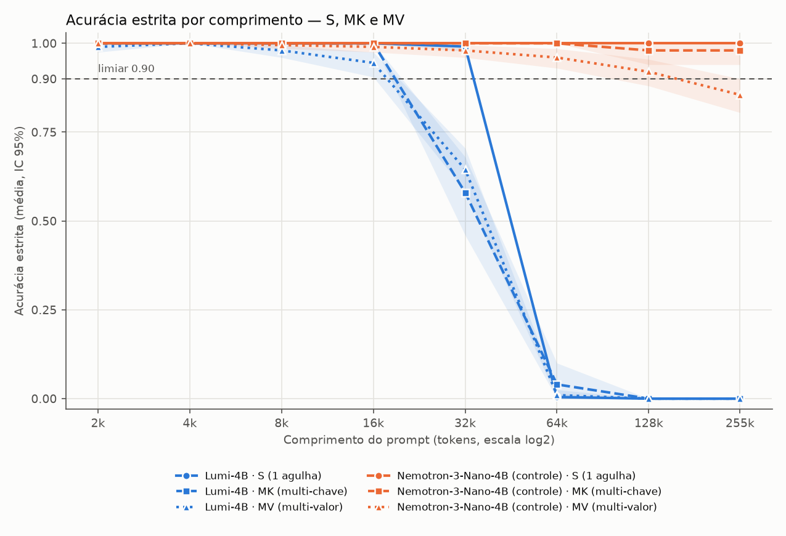
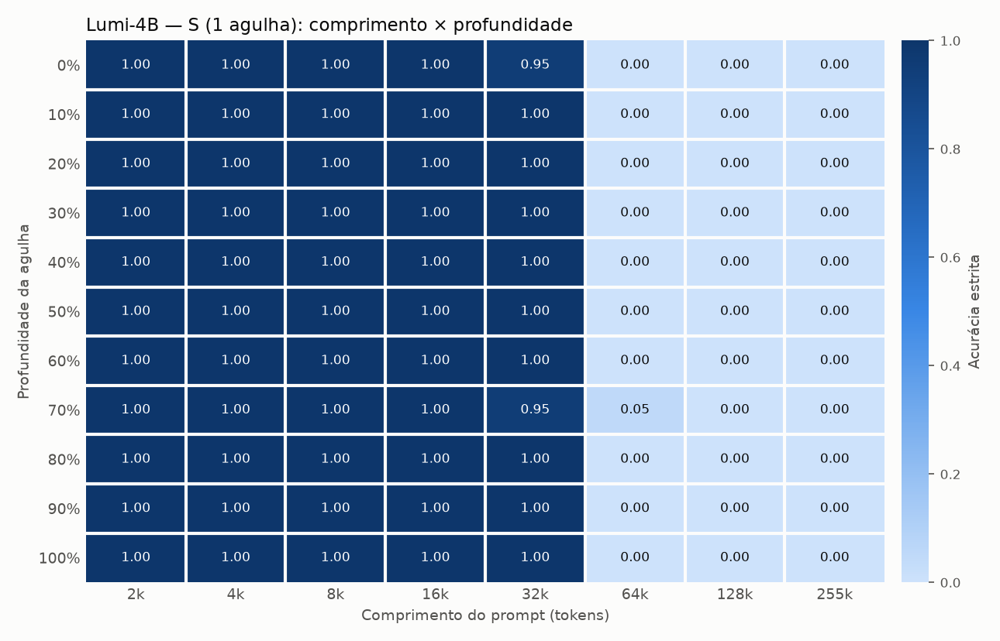
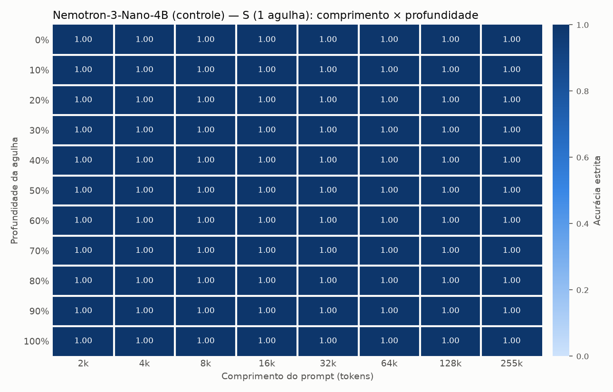
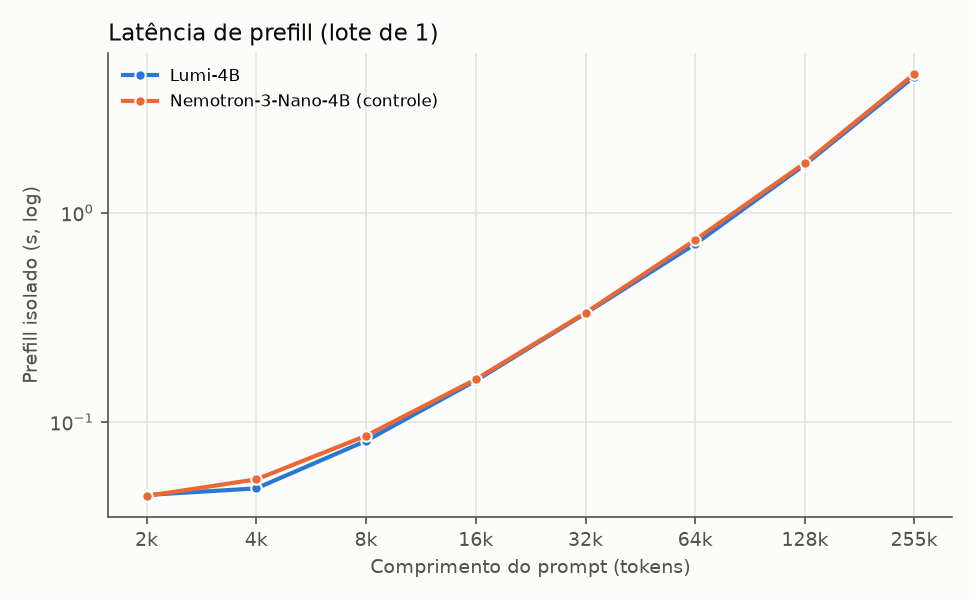

# Etapa 1 — Janela de contexto: relatório da execução `20261118-115243_full`

## 1. L\* por modelo

| Modelo | L\* (S) | L\*estrito (S) | L\* conservador (S) | L\* (MK) | L\* (MV) | C0 |
|---|---|---|---|---|---|---|
| Lumi-4B | 32k (32 768) | 32k (32 768) | 32k (32 768) | 16k (16 384) | 16k (16 384) | 1.00 |
| Nemotron-3-Nano-4B (controle) | 255k (261 120) | 255k (261 120) | 255k (261 120) | 255k (261 120) | 128k (131 072) | 1.00 |

- **L\***: maior L com acurácia estrita média de S ≥ 0.90 nele e em todos os comprimentos menores.
- **L\*estrito**: idem, exigindo ≥ 0.90 em **toda** profundidade.
- **L\* conservador**: idem, usando o limite inferior do IC 95 % (bootstrap) em vez da média.
- MK e MV usam a acurácia estrita média (no MV, a fração dos 4 valores recuperados).
- ⚠️ = algum gate essencial (G1, G2, G3 ou G6) falhou para o modelo; o L\* dele não é confiável.

## 2. Lumi × controle

**S (1 agulha)** — acurácia estrita média [IC 95 %]

| L | Lumi-4B | Nemotron-3-Nano-4B (controle) | Δ (alvo − controle) | p (pareado) |
|---|---|---|---|---|
| 2k | 1.00 [1.00, 1.00] | 1.00 [1.00, 1.00] | +0.00 | 1 |
| 4k | 1.00 [1.00, 1.00] | 1.00 [1.00, 1.00] | +0.00 | 1 |
| 8k | 1.00 [1.00, 1.00] | 1.00 [1.00, 1.00] | +0.00 | 1 |
| 16k | 1.00 [1.00, 1.00] | 1.00 [1.00, 1.00] | +0.00 | 1 |
| 32k | 0.99 [0.98, 1.00] | 1.00 [1.00, 1.00] | -0.01 | 0.5 |
| 64k | 0.00 [0.00, 0.01] | 1.00 [1.00, 1.00] | -1.00 | 2.37e-66 |
| 128k | 0.00 [0.00, 0.00] | 1.00 [1.00, 1.00] | -1.00 | 1.19e-66 |
| 255k | 0.00 [0.00, 0.00] | 1.00 [1.00, 1.00] | -1.00 | 1.19e-66 |

**MK (multi-chave)** — acurácia estrita média [IC 95 %]

| L | Lumi-4B | Nemotron-3-Nano-4B (controle) | Δ (alvo − controle) | p (pareado) |
|---|---|---|---|---|
| 2k | 1.00 [1.00, 1.00] | 1.00 [1.00, 1.00] | +0.00 | 1 |
| 4k | 1.00 [1.00, 1.00] | 1.00 [1.00, 1.00] | +0.00 | 1 |
| 8k | 1.00 [1.00, 1.00] | 1.00 [1.00, 1.00] | +0.00 | 1 |
| 16k | 1.00 [1.00, 1.00] | 1.00 [1.00, 1.00] | +0.00 | 1 |
| 32k | 0.58 [0.46, 0.68] | 1.00 [1.00, 1.00] | -0.42 | 9.54e-07 |
| 64k | 0.04 [0.00, 0.10] | 1.00 [1.00, 1.00] | -0.96 | 7.11e-15 |
| 128k | 0.00 [0.00, 0.00] | 0.98 [0.94, 1.00] | -0.98 | 3.55e-15 |
| 255k | 0.00 [0.00, 0.00] | 0.98 [0.94, 1.00] | -0.98 | 3.55e-15 |

**MV (multi-valor)** — acurácia estrita média [IC 95 %]

| L | Lumi-4B | Nemotron-3-Nano-4B (controle) | Δ (alvo − controle) | p (pareado) |
|---|---|---|---|---|
| 2k | 0.99 [0.97, 1.00] | 1.00 [1.00, 1.00] | -0.01 | 0.5 |
| 4k | 1.00 [1.00, 1.00] | 1.00 [1.00, 1.00] | +0.00 | 1 |
| 8k | 0.98 [0.96, 0.99] | 0.99 [0.98, 1.00] | -0.02 | 0.375 |
| 16k | 0.94 [0.91, 0.97] | 0.99 [0.97, 1.00] | -0.05 | 0.0391 |
| 32k | 0.65 [0.58, 0.70] | 0.98 [0.96, 0.99] | -0.33 | 1.46e-10 |
| 64k | 0.01 [0.00, 0.03] | 0.96 [0.93, 0.98] | -0.95 | 1.78e-15 |
| 128k | 0.00 [0.00, 0.00] | 0.92 [0.88, 0.95] | -0.92 | 1.78e-15 |
| 255k | 0.00 [0.00, 0.00] | 0.85 [0.81, 0.90] | -0.85 | 1.78e-15 |

p: teste exato dos sinais sobre os pares (mesmo prompt nos dois modelos); com notas 0/1 equivale ao McNemar exato. Os prompts são idênticos token a token nos dois modelos (mesmo tokenizer e template).

**Modos de falha** (S, MK e MV juntos; fração dos prompts de cada comprimento)

| Modelo | L | n | Erro (estrito) | Cortada no limite (laço) | Sem número | Com <think> | Nº distrator (MK) |
|---|---|---|---|---|---|---|---|
| Lumi-4B | 2k | 320 | 0.01 | 0.00 | 0.00 | 0.00 | 0.00 |
| Lumi-4B | 4k | 320 | 0.00 | 0.00 | 0.00 | 0.00 | 0.00 |
| Lumi-4B | 8k | 320 | 0.01 | 0.00 | 0.00 | 0.00 | 0.00 |
| Lumi-4B | 16k | 320 | 0.03 | 0.01 | 0.00 | 0.00 | 0.00 |
| Lumi-4B | 32k | 320 | 0.20 | 0.07 | 0.00 | 0.00 | 0.07 |
| Lumi-4B | 64k | 320 | 0.99 | 0.64 | 0.97 | 0.38 | 0.00 |
| Lumi-4B | 128k | 320 | 1.00 | 0.90 | 1.00 | 0.85 | 0.00 |
| Lumi-4B | 255k | 320 | 1.00 | 0.92 | 1.00 | 0.99 | 0.00 |
| Nemotron-3-Nano-4B (controle) | 2k | 320 | 0.00 | 0.00 | 0.00 | 0.00 | 0.00 |
| Nemotron-3-Nano-4B (controle) | 4k | 320 | 0.00 | 0.00 | 0.00 | 0.00 | 0.00 |
| Nemotron-3-Nano-4B (controle) | 8k | 320 | 0.00 | 0.00 | 0.00 | 0.00 | 0.00 |
| Nemotron-3-Nano-4B (controle) | 16k | 320 | 0.01 | 0.00 | 0.00 | 0.00 | 0.00 |
| Nemotron-3-Nano-4B (controle) | 32k | 320 | 0.01 | 0.00 | 0.00 | 0.00 | 0.00 |
| Nemotron-3-Nano-4B (controle) | 64k | 320 | 0.02 | 0.00 | 0.00 | 0.00 | 0.00 |
| Nemotron-3-Nano-4B (controle) | 128k | 320 | 0.04 | 0.00 | 0.00 | 0.00 | 0.00 |
| Nemotron-3-Nano-4B (controle) | 255k | 320 | 0.07 | 0.00 | 0.00 | 0.00 | 0.00 |

Uma resposta correta tem poucos tokens; ser cortada no limite de `max_tokens` indica laço ou degeneração. `<think>` fora do C0/contextos curtos aparece como parte desse colapso, não como erro de configuração (o gate G3 cobre o C0 e os contextos curtos). Ver `failure_modes.csv`.

## 3. Recomendação para a Etapa 2

- **Pela regra da especificação (L\* de S = 32k (32 768)): Documento inteiro.** Isto é, codificar documentos inteiros até 32k (32 768), com currículo de comprimento até lá.
- **Ressalva — várias agulhas: L\* efetivo = 16k (16 384) (MK/MV) → Chunks de 4k a 8k tokens.** Em 32k (32 768) a acurácia já cai (MK 0.58, MV 0.65). Um embedder precisa distinguir muitos fatos parecidos no mesmo documento, então o critério mais seguro é o menor L\* entre as tarefas: usar *chunking* com janelas de 4k–8k e treinar o embedder nesse regime.
- **Sem margem acima de L\*.** Em 64k a acurácia de S cai para 0.00: é um colapso (saídas degeneradas, ver 'Modos de falha'), não uma degradação gradual. Documentos pouco acima de L\* falham por completo.
- **Perda grande, atribuível ao pré-treino contínuo.** Controle: L\* = 255k (261 120); Lumi: 32k (32 768) (~8× menor), com os mesmos prompts. Como a base mantém o contexto longo, ele deve ser recuperável: para documentos acima de L\*, a Etapa 4 precisa de um fine-tuning de contexto longo antes do treino contrastivo.

Tabela de decisão (§1 da especificação): L\* ≥ 32k → documento inteiro; L\* ≈ 8k → chunks de 4k–8k; L\* < 8k → reavaliar.

## 4. Gates, versões e duração

| Modelo | Gate | Critério |  | Detalhe |
|---|---|---|---|---|
| Lumi-4B | G1 | Template com thinking desligado | ✅ | prompt termina em 'art|>assistant\n<think></think>' |
| Lumi-4B | G2 | C0 (sem palheiro) ≥ 95% | ✅ | acurácia estrita 1.000 |
| Lumi-4B | G3 | Nenhum <think> no C0 nem em L ≤ 8k | ✅ | 0 no escopo; 713 acima de 8k (modo de falha, seção 2) |
| Lumi-4B | G4 | Comprimento dentro de ±2% e ≤ L | ✅ | desvio máx. 0.0198; 0 acima do alvo |
| Lumi-4B | G5 | Número da agulha ausente do palheiro | ✅ | verificado na construção; 0 número(s) re-sorteado(s) |
| Lumi-4B | G6 | Todas as gerações concluídas | ✅ | 0 faltando de 2610 |
| Nemotron-3-Nano-4B (controle) | G1 | Template com thinking desligado | ✅ | prompt termina em 'art|>assistant\n<think></think>' |
| Nemotron-3-Nano-4B (controle) | G2 | C0 (sem palheiro) ≥ 95% | ✅ | acurácia estrita 1.000 |
| Nemotron-3-Nano-4B (controle) | G3 | Nenhum <think> no C0 nem em L ≤ 8k | ✅ | 0 no escopo; 0 acima de 8k (modo de falha, seção 2) |
| Nemotron-3-Nano-4B (controle) | G4 | Comprimento dentro de ±2% e ≤ L | ✅ | desvio máx. 0.0198; 0 acima do alvo |
| Nemotron-3-Nano-4B (controle) | G5 | Número da agulha ausente do palheiro | ✅ | verificado na construção; 0 número(s) re-sorteado(s) |
| Nemotron-3-Nano-4B (controle) | G6 | Todas as gerações concluídas | ✅ | 0 faltando de 2610 |

| Item | Valor |
|---|---|
| Imagem (config / ambiente) | `vllm/vllm-openai:v0.29.0` / `vllm/vllm-openai:v0.29.0` |
| vLLM | 0.29.0 |
| transformers | 5.16.1 |
| torch (CUDA) | 2.13.0+cu130 (13.0) |
| Driver NVIDIA (CUDA do driver) | 590.48.01 (13.1) |
| GPUs usadas | 1× NVIDIA B200 (179 GiB); workers: 1 |
| Modelos | `ceia-research/lumi-4b@27b30f40b930`; `nvidia/NVIDIA-Nemotron-3-Nano-4B-BF16@dfaf35de3e30` |
| Commit do código | `86c5a54af9138541b8322d32e176919c4518a174` |
| Início / fim | 2026-11-18T11:52:43 / 2026-11-18T13:16:57 |
| Duração total | 1.40 h (84 min) |
| Opções do vLLM | `{"seed": 1234, "dtype": "bfloat16", "max_model_len": 262144, "gpu_memory_utilization": 0.9, "mamba_ssm_cache_dtype": "float32", "enable_prefix_caching": false, "max_num_seqs": 64, "max_num_batched_tokens": 32768, "trust_remote_code": true}` |

Tempo por fase: ambiente 0.1 min; tokenizers_e_template 0.2 min; palheiro 0.0 min; prompts 2.2 min; download_modelos 0.0 min; geracao_lumi 40.8 min; geracao_nemotron 41.0 min; pontuacao 0.0 min.

## 5. Desempenho (secundário)

| Modelo | L | Prefill (s) | Prefill (tok/s) | Decode (tok/s) | KV teórico (GiB) |
|---|---|---|---|---|---|
| Lumi-4B | 2k | 0.045 | 45 108 | 338.5 | 0.03 |
| Lumi-4B | 4k | 0.048 | 84 643 | 374.6 | 0.06 |
| Lumi-4B | 8k | 0.081 | 100 536 | 353.1 | 0.12 |
| Lumi-4B | 16k | 0.158 | 103 484 | 380.5 | 0.25 |
| Lumi-4B | 32k | 0.330 | 99 050 | 376.9 | 0.50 |
| Lumi-4B | 64k | 0.709 | 92 293 | 371.4 | 1.00 |
| Lumi-4B | 128k | 1.696 | 77 176 | 441.5 | 2.00 |
| Lumi-4B | 255k | 4.459 | 58 533 | 501.2 | 3.98 |
| Nemotron-3-Nano-4B (controle) | 2k | 0.044 | 45 626 | 336.5 | 0.03 |
| Nemotron-3-Nano-4B (controle) | 4k | 0.053 | 76 667 | 359.7 | 0.06 |
| Nemotron-3-Nano-4B (controle) | 8k | 0.086 | 95 116 | 348.0 | 0.12 |
| Nemotron-3-Nano-4B (controle) | 16k | 0.160 | 102 027 | 346.5 | 0.25 |
| Nemotron-3-Nano-4B (controle) | 32k | 0.332 | 98 462 | 359.7 | 0.50 |
| Nemotron-3-Nano-4B (controle) | 64k | 0.741 | 88 306 | 393.6 | 1.00 |
| Nemotron-3-Nano-4B (controle) | 128k | 1.728 | 75 749 | 400.2 | 2.00 |
| Nemotron-3-Nano-4B (controle) | 255k | 4.592 | 56 844 | 607.0 | 3.98 |

Medido com lote de 1 (latência isolada), mediana das repetições; ver `perf.csv`. "–" = nenhuma medida de decode válida (a geração parou antes dos tokens pedidos).

Memória teórica (lumi): 4 camadas de atenção × 2 (K, V) × 8 cabeças KV × 128 dimensões × 2 bytes = **16 KiB/token** (≈ 4.0 GiB em 262 144 tokens); estado Mamba (fp32) ≈ **82.6 MB por sequência**, constante. Chaves `rope_*` no config: não.

## 6. Detalhes do experimento

- Palheiro: `wikimedia/wikipedia` @ `b04c8d1ceb2f`, 2560 artigos, 4.20M tokens, 110045 frases.
- Prompts (lumi): 2610 | desvio máx. de comprimento 0.0198 | 77 com início re-sorteado | C0 com ~95 tokens.
- Prompts (nemotron): 2610 | desvio máx. de comprimento 0.0198 | 77 com início re-sorteado | C0 com ~95 tokens.

**Acurácia de S por profundidade no L\* de cada modelo:**

| Profundidade | Lumi-4B @ 32k | Nemotron-3-Nano-4B (controle) @ 255k |
|---|---|---|
| 0% | 0.95 | 1.00 |
| 10% | 1.00 | 1.00 |
| 20% | 1.00 | 1.00 |
| 30% | 1.00 | 1.00 |
| 40% | 1.00 | 1.00 |
| 50% | 1.00 | 1.00 |
| 60% | 1.00 | 1.00 |
| 70% | 0.95 | 1.00 |
| 80% | 1.00 | 1.00 |
| 90% | 1.00 | 1.00 |
| 100% | 1.00 | 1.00 |

- 7 desvio(s) da especificação registrado(s) em `DESVIOS.md`.

Arquivos: `summary.csv`, `by_depth_S.csv`, `paired_tests.csv`, `failure_modes.csv`, `perf.csv`, `lstar.json`, `raw/results.jsonl` (uma linha por prompt e modelo), `config_used.yaml`, `env.json`, `logs/`.

